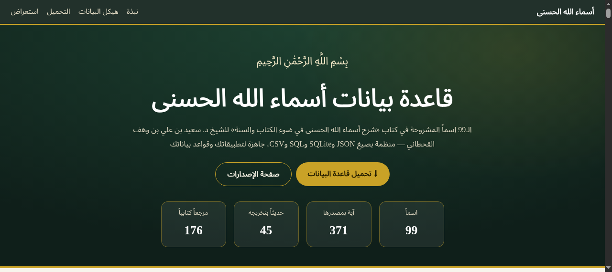
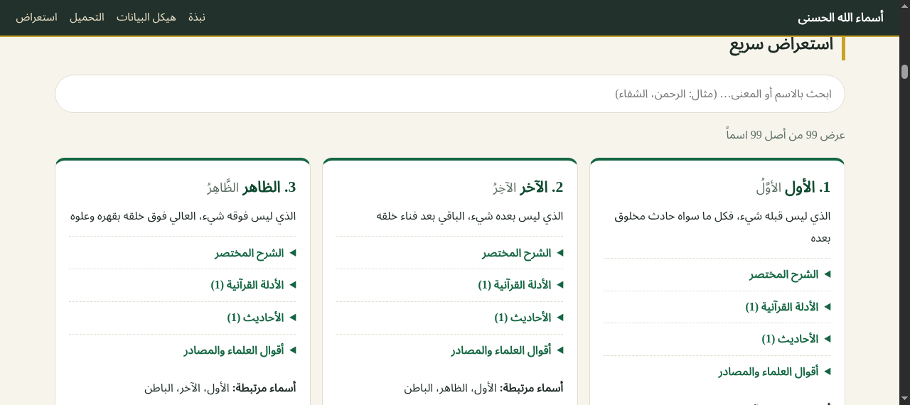

<div dir="rtl">

# أسماء الله الحسنى — قاعدة بيانات مفتوحة

[](https://github.com/rn0x/Names_Of_Allah_Json/releases/latest)
[](https://github.com/rn0x/Names_Of_Allah_Json/releases)
[](LICENSE)
[](https://rn0x.github.io/Names_Of_Allah_Json/)

قاعدة بيانات منظّمة ومجانية للأسماء الحسنى **التسعة والتسعين** المشروحة في كتاب «شرح أسماء الله الحسنى في ضوء الكتاب والسنة»، صالحة للاستخدام المباشر في التطبيقات وقواعد البيانات وواجهات البرمجة (API)، مع موقع تعريفي لتحميلها.

**🌐 الموقع:** https://rn0x.github.io/Names_Of_Allah_Json/ — **⬇️ التحميل:** [صفحة الإصدارات](https://github.com/rn0x/Names_Of_Allah_Json/releases/latest)




## الكتاب المصدر

| البيان | التفصيل |
|---|---|
| الكتاب | شرح أسماء الله الحسنى في ضوء الكتاب والسنة |
| المؤلف | د. سعيد بن علي بن وهف القحطاني |
| نوع الكتاب | شرح عقدي في توحيد الأسماء والصفات |
| القسم | العقيدة |
| الناشر | مطبعة سفير، الرياض (توزيع مؤسسة الجريسي) |
| عدد الصفحات | 264 (الترقيم موافق للمطبوع) |
| المبحث المستخرج منه | المبحث الخامس عشر: شرح أسماء الله الحسنى |
| رابط الكتاب | [المكتبة الشاملة](https://shamela.ws/book/96493) |

## محتويات المستودع

```
Names_Of_Allah_Json/
├── asma_allah_alhusna_saeed_alqahtani.json  # الملف الرئيسي (99 سجلاً)
├── data/
│   ├── asma_allah_alhusna.db                # قاعدة SQLite جاهزة
│   ├── asma_allah_alhusna.sql               # نسخة SQL
│   └── asma_allah_alhusna_full.csv          # ملف CSV واحد شامل (956 صفاً)
├── docs/                                    # الموقع التعريفي (GitHub Pages)
│   ├── index.html
│   ├── assets/css/style.css
│   ├── assets/js/app.js
│   ├── assets/img/                          # لقطات الموقع
│   └── downloads/                           # نسخ التحميل المباشر
├── scripts/
│   └── build_formats.py                     # توليد الصيغ من ملف JSON
├── LICENSE
└── README.md
```

## هيكل البيانات ومعنى كل حقل

كل اسم سجلٌ مستقل بهذه الحقول:

| الحقل | المعنى | مثال |
|---|---|---|
| `id` | ترتيب الاسم عند المؤلف (1–99) | `84` |
| `name` | الاسم مجرداً من التشكيل | `الجميل` |
| `name_arabic` | الاسم بالتشكيل كما في الكتاب | `الجَميلُ` |
| `meaning` | معنى الاسم باختصار | `الذي له الجمال المطلق...` |
| `explanation` | خلاصة شرح المؤلف (لا نسخ كامل) | نص مختصر ≤ 2000 حرف |
| `quran_evidence` | آيات الاستدلال، كل آية مع مصدرها | `{text, source: "سورة الأعراف، الآية: ١٨٠."}` |
| `hadith_evidence` | الأحاديث المرتبطة بالاسم مع تخريجها | `{text, source: "أخرجه مسلم... برقم ٩١."}` |
| `scholarly_statements` | أقوال العلماء المنقولة في الشرح (ابن القيم، السعدي، ابن كثير...) | نصوص مقتبسة |
| `sources` | المراجع الكتابية من الحواشي | `تفسير السعدي، ٥/ ٤٠٥` |
| `related_names` | أسماء يشرحها المؤلف معاً | `["الأعلى", "المتعال"]` للعلي |
| `book_reference` | المرجع: الصفحة + المبحث + رابط مباشر لصفحة الشاملة | `page: 180` |

> `source: null` تعني أن المؤلف لم يرقّم استشهاداً لهذا الدليل — لم يُخترع أي مصدر أو رقم أو صفحة.

### جداول SQLite

`names` · `quran_evidence` · `hadith_evidence` · `scholarly_statements` · `sources` · `related_names` · `meta` (بيانات الكتاب والإصدار).

### ملف CSV الواحد

أعمدة: `id, name, name_arabic, category, text, source, page, chapter, url` حيث `category` إحدى: `meaning` · `explanation` · `quran` · `hadith` · `scholarly` · `source` · `related` — بترميز UTF-8 مع BOM ليعمل مباشرة مع Excel العربي.

## إحصاءات المحتوى

| البيان | العدد |
|---|---|
| الأسماء | 99 |
| الآيات المستشهد بها (مع مصادرها) | 371 |
| الأحاديث المرتبطة (مع تخريجها) | 45 |
| أقوال العلماء المنقولة | 27 |
| المراجع الكتابية | 176 |

## التحميل

من **[صفحة الإصدارات](https://github.com/rn0x/Names_Of_Allah_Json/releases/latest)** (تُحتسب التحميلات هناك):

| الصيغة | الملف | الحجم |
|---|---|---|
| JSON | `asma_allah_alhusna_saeed_alqahtani.json` | ~423KB |
| SQLite | `asma_allah_alhusna.db` | ~508KB |
| SQL | `asma_allah_alhusna.sql` | ~406KB |
| CSV | `asma_allah_alhusna_full.csv` | ~500KB |

أو مباشرة من الموقع: https://rn0x.github.io/Names_Of_Allah_Json/

## أمثلة الاستخدام

**JavaScript:**
```js
const names = await (await fetch('asma_allah_alhusna_saeed_alqahtani.json')).json();
console.log(names[0].name, '-', names[0].meaning);
```

**Python + SQLite:**
```python
import sqlite3
con = sqlite3.connect('data/asma_allah_alhusna.db')
for name, meaning in con.execute('SELECT name, meaning FROM names LIMIT 3'):
    print(name, '-', meaning)
```

**SQL — آيات اسم الشافي مع مصادرها:**
```sql
SELECT q.text, q.source
FROM names n JOIN quran_evidence q ON q.name_id = n.id
WHERE n.name = 'الشافي';
```

**إعادة توليد الصيغ من JSON:**
```bash
python3 scripts/build_formats.py
```

## منهجية الاستخراج

1. جُلبت صفحات الكتاب (188 صفحة) من المكتبة الشاملة.
2. قُسّم النص حسب عناوين الأسماء الـ99 بترتيب المؤلف (الأسماء المشروحة معاً تشترك في الشرح).
3. رُبطت كل آية وحديث برقم حاشيتها في الصفحة نفسها — لا بالتخمين.
4. الأحاديث المُثبتة هي المرتبطة بالاسم فقط (المذكور فيها أو في موضوعه المباشر).
5. الشرح ملخّص غير منسوخ كاملاً، مع اقتباسات قصيرة عند الحاجة.

## تنبيه الحقوق

- **متن الكتاب الأصلي** حقٌّ للمؤلف والناشر — ما هنا ملخصات واقتباسات قصيرة موثقة لغرض تعليمي وبحثي مع الإحالة للمصدر.
- **هيكلة البيانات والسكربتات والموقع** في هذا المستودع تحت رخصة [MIT](LICENSE) © 2026 rn0x.

</div>
