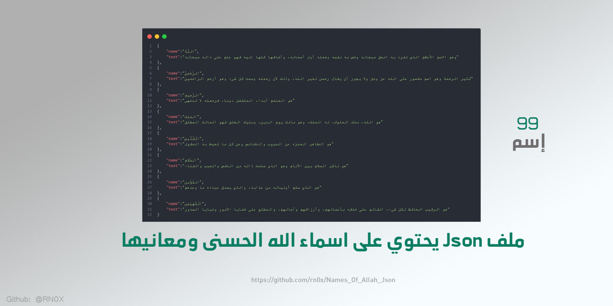
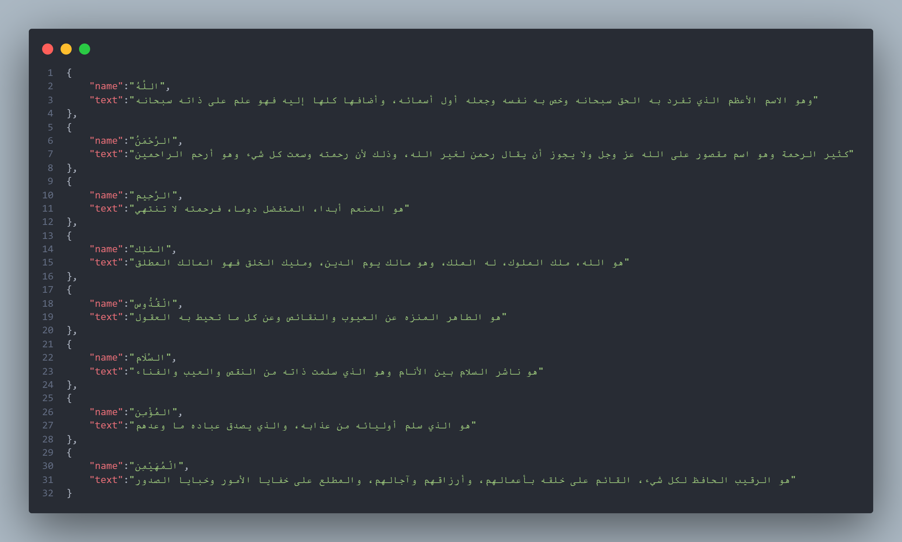

<div align="center"> 
    
</div>


#  أسماء الله الحسنى

أسماء مدح وحمد وثناء وتمجيد الله وصفات كمال الله ونعوت جلال الله، وأفعال حكمة ورحمة ومصلحة وعدل من الله، يدعى الله بها، وتقتضي المدح والثناء بنفسها، سمى الله بها نفسه في كتبه أو على لسان أحد من رسله أو استأثر الله بها في علم الغيب عنده، عددها 99 اسماً لا يشبهه ولا يماثله فيها أحد، وهي حسنى يراد منها قصر كمال الحسن في أسماء الله، لا يعلمها كاملة وافية إلا الله

<br>

<br><br>

## تفاصيل ملف json 

id = معرف الإسم <sub> - number</sub><br>
name = الإسم <sub> - string</sub><br>
text = معنى الإسم <sub> - string</sub><br>

<br><br>

Example File Json 

```json

[
    {
        "id": 1,
        "name":"اللَّهُ",
        "text":"وهو الاسم الأعظم الذي تفرد به الحق سبحانه وخص به نفسه وجعله أول أسمائه، وأضافها كلها إليه فهو علم على ذاته سبحانه"
    },
    {
        "id": 2,
        "name":"الرَّحْمَنُ",
        "text":"كثير الرحمة وهو اسم مقصور على الله عز وجل ولا يجوز أن يقال رحمن لغير الله، وذلك لأن رحمته وسعت كل شيء وهو أرحم الراحمين"
    },
    {
        "id": 3,
        "name":"الرَّحِيم",
        "text":"هو المنعم أبدا، المتفضل دوما، فرحمته لا تنتهي"
    },
    {
        "id": 4,
        "name":"المَلِك",
        "text":"هو الله، ملك الملوك، له الملك، وهو مالك يوم الدين، ومليك الخلق فهو المالك المطلق"
    },
    {
        "id": 5,
        "name":"الْقُدُّوس",
        "text":"هو الطاهر المنزه عن العيوب والنقائص وعن كل ما تحيط به العقول"
    },
]

```

<br><br>


<div align="center"> 
    <b>مثال لملف json</b>
    <br><br>
    
</div>

<br><br>

# قاعدة بيانات الأسماء الحسنى الـ99 من كتاب القحطاني (JSON + SQLite + موقع)

إضافة جديدة: استخراج منظم للـ99 اسماً المشروحة في كتاب **«شرح أسماء الله الحسنى في ضوء الكتاب والسنة»** (د. سعيد القحطاني) — بالمعاني والأدلة القرآنية والحديثية (كلٌّ مع مصدره) وأقوال العلماء والمراجع، بنفس ترتيب المؤلف.

- **الموقع التعريفي للتحميل:** https://rn0x.github.io/Names_Of_Allah_Json/
- **الملف الرئيسي:** [`asma_allah_alhusna_saeed_alqahtani.json`](asma_allah_alhusna_saeed_alqahtani.json)
- **قاعدة SQLite:** [`data/asma_allah_alhusna.db`](data/asma_allah_alhusna.db) · **SQL:** [`data/asma_allah_alhusna.sql`](data/asma_allah_alhusna.sql) · **CSV:** [`data/`](data/)
- **التفاصيل الكاملة:** [README الجديد](https://github.com/rn0x/Names_Of_Allah_Json/tree/main/docs) · المصدر: [المكتبة الشاملة](https://shamela.ws/book/96493)
